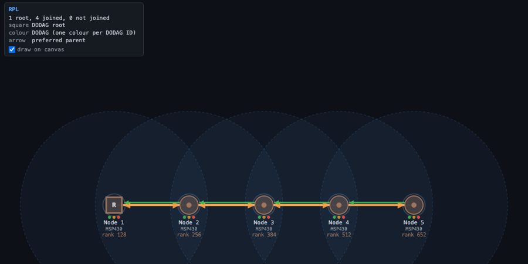

<p align="center">
  <picture>
    <source media="(prefers-color-scheme: dark)" srcset="docs/assets/cooja-ng-logo-dark.svg">
    
  </picture>
</p>
<p align="center">
  <a href="https://github.com/mikroverk/cooja-ng/releases/latest"></a>
  <a href="https://github.com/mikroverk/cooja-ng/actions/workflows/test.yml"></a>
  <a href="LICENSE"></a>
  <a href="https://github.com/mikroverk/cooja-ng/stargazers"></a>
</p>

# Cooja-NG — emulate the devices, simulate the network, run the real firmware

Cooja-NG runs unmodified **Contiki-NG, Zephyr, RIOT and OpenThread** firmware on emulated MSP430 and Cortex-M boards — Nordic nRF52840 and nRF54L15, TI CC2538 and CC13x2, the MSP430 motes — from the CPU and peripherals to the radio chip, and puts the boards in one simulated IEEE 802.15.4 network, 2.4 GHz and sub-GHz.  The same seed gives the same run, byte for byte: on your laptop, headless in CI, or in the browser.

<p align="center"></p>

### ▶ [Try it in your browser](https://mikroverk.github.io/cooja-ng/) — no install

The simulator, compiled to WebAssembly ([`wasm/`](wasm/README.md)), runs the original firmware in the tab: a Thread network, Contiki-NG talking to Zephyr and to RIOT, three CPU architectures on one RPL network, TSCH, a 100-node grid.

### Quick start

Download a [release](https://github.com/mikroverk/cooja-ng/releases/latest) (Linux x86-64, macOS arm64 and x86-64), or build it:

```sh
git clone https://github.com/mikroverk/cooja-ng.git && cd cooja-ng
make && make install PREFIX=~/.local     # cngsim into ~/.local/bin
cngsim run rpl-udp-sky --ui              # a Contiki-NG network, in the web UI
```

### Other firmware

```sh
cngsim run zephyr-echo        # Zephyr's stock echo_server/echo_client, nRF52840 DK
cngsim run contiki-zephyr     # Contiki-NG and Zephyr on one network
cngsim run riot-rpl           # RIOT GNRC nodes forming an RPL network
cngsim run thread-cc2538      # OpenThread ot-cli-ftd: a Thread network
```

Each exits 0 when its checks pass and 1 when one fails, so it drops into CI as it is.  Your own build runs too: `cngsim run build/zephyr/zephyr.elf` reads the board from a west build.

### What runs where

Contiki-NG is the validated target: Contiki-NG's own Cooja test suite passes headless, 93 / 93 (8 of them need `--with-tun` and root).  Zephyr, RIOT and OpenThread support is newer and **experimental**.

| | Tmote Sky, Z1 (MSP430) | CC2538DK | Firefly | nRF52840 DK | nRF52840 Dongle | nRF54L15 DK / XIAO | CC1352R1 LaunchPad | CC1312R7 LaunchPad |
|---|---|---|---|---|---|---|---|---|
| **Contiki-NG** | runs+radio | runs+radio | runs+radio | runs+radio | runs+radio | runs+radio | runs+radio | runs+radio |
| **Zephyr** | — | — | — | runs+radio | not yet | not yet | runs+radio | boots only¹ |
| **RIOT** | not yet | not yet² | not yet² | runs+radio | not yet | not yet | boots only | not yet |
| **OpenThread** | — | runs+radio | not yet | runs+radio | not yet | not yet | not yet | not yet |

*runs+radio*: forms a network over the simulated radio; *boots only*: boots and runs its sample, radio not exercised yet; *not yet*: untested or unsupported; —: the OS does not target that board.
¹ Zephyr has no CC1312R7 LaunchPad board upstream; the image uses an out-of-tree board.  ² RIOT builds for these boards are untested here.
Details: [docs/zephyr.md](docs/zephyr.md), [docs/riot.md](docs/riot.md), [docs/openthread.md](docs/openthread.md), [`devices/`](devices/).

## Start here if you use…

New to Zephyr, RIOT or OpenThread on Cooja-NG? [docs/zephyr-riot-openthread.md](docs/zephyr-riot-openthread.md) gets each one running in three steps.

- **OpenThread.** `ot-cli-ftd` from the ot-cc2538 and ot-nrf528xx ports, unmodified, forms a Thread network on emulated CC2538s and nRF52840s, and the canvas draws its roles and partitions the way OTNS does: `cngsim run thread-cc2538 --ui`, and `cngsim new thread -n 8 --board cc2538dk` for a network of your own.  [docs/openthread.md](docs/openthread.md), with a section for [OTNS users](docs/openthread.md#coming-from-otns).
- **Zephyr.** The `nrf52840dk/nrf52840` image `west build` writes runs as it is, its `nrf_802154` driver and ACKs included: `cngsim run build/zephyr/zephyr.elf` finds the board in the build, and `cngsim run zephyr-echo` runs the stock echo samples.  [docs/zephyr.md](docs/zephyr.md)
- **RIOT.** `BOARD=nrf52840dk` builds of GNRC form an RPL network, with each other or with Contiki-NG (`cngsim run riot-rpl`, `cngsim run contiki-riot`), driven from RIOT's own shell by a script, and rehearse a FIT IoT-LAB run.  `--board` takes RIOT's and Zephyr's board names; `cngsim boards --os` lists them.  [docs/riot.md](docs/riot.md)
- **Contiki-NG.** The Cooja test suite runs headless, 93 of 93, and your own builds run on every radio board here (`cngsim boards` gives the `TARGET` and `BOARD` for each).  [docs/contiki-ng-testing.md](docs/contiki-ng-testing.md)
- **802.15.4 research.** CSMA and TSCH, 2.4 GHz and sub-GHz (`cngsim run tsch-subghz-cc1352r1`), the same seed giving the same run, with links you can cut and clocks you can drift.  [Make the radio worse on purpose](#make-the-radio-worse-on-purpose), and [docs/radio-medium.md](docs/radio-medium.md)

## At a glance

| | |
|---|---|
| **CPUs** | MSP430 and MSP430X; ARM Cortex-M3, M4F and M33 (with TrustZone-M); RISC-V RV32EMC (the nRF54L15's FLPR coprocessor).  Interpreters, with JITs for MSP430 and Thumb code |
| **Boards** | Tmote Sky, Zolertia Z1, MSP-EXP430FR5969; TI CC2538DK, Zolertia Firefly; Nordic nRF52840 DK and Dongle, nRF54L15 DK, Seeed XIAO nRF54L15; TI CC1352R1 and CC1312R7 LaunchPads ([table](#supported-platforms)) |
| **Firmware** | [Contiki-NG](docs/contiki-ng-testing.md) on every radio board, and its Cooja test suite passes, 93 / 93; [Zephyr](docs/zephyr.md), [RIOT](docs/riot.md) and [OpenThread](docs/openthread.md) images, stock, on the boards their guides list (experimental) |
| **Radios** | CC2420, the CC2538 RF core, CC1200 sub-GHz, the Nordic 802.15.4 radio, the TI CC13x2 RF core (sub-GHz and 2.4 GHz); a frame reaches the receiving radio byte by byte as it is on the air |
| **The air** | One medium for every node, by band and channel: a unit-disk model with interference range, success ratios and TX power, plus plugin media (random and bursty loss).  BLE and LoRa are not modelled |
| **Networks** | Up to 128 nodes, mixed architectures; native Cooja motes, JavaScript motes, external emulators and Renode as nodes too |
| **Determinism** | One event queue, one nanosecond clock: a seed gives a byte-identical run, with the JIT on or off, on Linux, macOS and FreeBSD; the browser build is checked against the native one |
| **Tools** | `cngsim` (headless, exit codes for CI); a web UI that edits the running network; network overlays drawn from firmware memory, as YAML you edit live; packets dissected in the browser; pcap; recording and replay; a shell and command scripts; GDB on ARM nodes; energy estimation; plugins |

## More commands

```sh
git clone https://github.com/mikroverk/cooja-ng.git && cd cooja-ng
make                                   # build/cngsim and build/test_runner
./build/cngsim examples                # bundled, commented simulations
./build/cngsim run rpl-udp-sky         # headless: node consoles, checks, verdict
./build/cngsim run rpl-udp-sky --ui    # watch it in the browser
./build/cngsim new rpl-udp --board nrf52840-dk -n 6 -o my-net.yaml   # your own setup
```

**[docs/quick-start.md](docs/quick-start.md)** is the guide: installing
(release tarballs, or `make install PREFIX=~/.local`), the web UI (add,
move, remove and reboot nodes, save the setup), your own Contiki-NG firmware,
checks, and a table for Cooja users.

`cngsim` is the command for running simulations.  `test_runner` is the
developer and CI binary: the emulator's unit suites, the Contiki-NG Cooja
suite, and the determinism gates, which diff its full output.  Both run the
same simulation.

## Make the radio worse on purpose

Set range, interference range and success ratios from the shell (the firmware's TX power scales its range, as in Cooja's UDGM).  Cut a link both ways or one way, drift a node's clock, schedule either for later, add bursty loss with the Gilbert–Elliott medium plugin, or put a jammer or a sniffer on the air as a short Python process ([`examples/ext/`](examples/ext/)).  Every run is seeded and byte-identical, and every frame can go to a pcap.

```
$ cngsim run chain-sky --shell
> radio range 30 60          # tx and interference range, metres
> radio success 0.9          # each transmission succeeds with p = 0.9
> link 3 -> 1 off            # node 1 stops hearing node 3
> clock 4 1.00002            # node 4 runs 20 ppm fast
> at 60s link 3 -> 1 on      # the link comes back at 60 s
> pcap chain.pcap
```

The same commands run from a `--script` with a verdict ([docs/shell.md](docs/shell.md)).  `make plugins` builds the loss media; [`configs/medium-plugin-gilbert-elliott.yaml`](configs/medium-plugin-gilbert-elliott.yaml) uses one, and [`configs/test-ext-jammer-sky.json`](configs/test-ext-jammer-sky.json) puts the jammer next to two Skys.  TSCH runs on the nRF52840, the CC2538 and, sub-GHz, the CC1352R1 LaunchPad in TI's proprietary mode ([`configs/test-tsch-cc1352r1-launchpad.yaml`](configs/test-tsch-cc1352r1-launchpad.yaml)).

### What Cooja-NG does not model

- BLE, LoRa and Wi-Fi radios: the medium carries IEEE 802.15.4 (2.4 GHz) and 802.15.4g (sub-GHz) frames.
- Propagation beyond the unit-disk model: no path loss, fading, SINR or capture.  Cooja's other media (DGRM, MRM, LogisticLoss) are refused when a `.csc` is converted, not approximated.
- More than 128 nodes in one simulation.
- Wi-SUN: the CC1200 and the CC13x2 send 802.15.4g frames, but no Wi-SUN stack has been run.
- Flash timing: an erase or a write completes at once.
- The nRF52840's CryptoCell; OpenThread's RCP and POSIX builds and border routers.

## Compared with

| | Cooja-NG | OTNS | Renode | Zephyr native_sim, nrf52_bsim | ns-3 lr-wpan | Cooja (Java) |
|---|---|---|---|---|---|---|
| What runs | the ELF built for the board | OpenThread POSIX instances, on the `ot-rfsim` platform | the board's firmware on emulated CPUs | the app, Zephyr and (bsim) hardware models, built as a Linux executable | ns-3's protocol models | MSP430 images on MSPSim; Contiki-NG built for the host; Java motes |
| CPU emulated | MSP430, Cortex-M3/M4F/M33, RV32E | no | yes | no | no | MSP430 |
| 802.15.4 medium | unit-disk, byte by byte, 2.4 GHz and sub-GHz | selectable models: ideal, mutual interference, outdoor | medium functions: every node, a range, a range with loss | BabbleSim's PHY (nrf52_bsim) | a SpectrumPhy-based PHY, 2.4 GHz O-QPSK | UDGM, DGRM, MRM, LogisticLoss |
| BLE | no | no | yes | yes (bsim; native_sim through a host or virtual controller) | not in the model library | no |
| Stacks | Contiki-NG; Zephyr, RIOT, OpenThread (experimental) | OpenThread | what runs on the emulated board | Zephyr | ns-3's own (6LoWPAN, Zigbee) | Contiki-NG |

Sources (November 2026): [OTNS](https://github.com/openthread/ot-ns) and its [CLI reference](https://github.com/openthread/ot-ns/blob/main/cli/README.md); [Renode wireless networking](https://renode.readthedocs.io/en/latest/networking/wireless.html); Zephyr's [native_sim](https://docs.zephyrproject.org/latest/boards/native/native_sim/doc/index.html) and [BabbleSim](https://docs.zephyrproject.org/latest/develop/test/bsim.html) pages; ns-3's [lr-wpan model](https://www.nsnam.org/docs/models/html/lr-wpan.html) and [model library](https://www.nsnam.org/docs/models/html/index.html); [Cooja](https://github.com/contiki-ng/cooja)'s `radiomediums` and `mrm` sources.  Each tool does more than one row can say; corrections are welcome as issues.

## Where it comes from

**The cross-level simulator Cooja pioneered, generalised: more CPUs, more firmware stacks, more radios.**

[Cooja](https://github.com/contiki-ng/cooja) introduced *cross-level* simulation: one simulation at the network, operating-system and machine-code instruction-set levels at once (F. Österlind, A. Dunkels, J. Eriksson, N. Finne and T. Voigt, "Cross-Level Sensor Network Simulation with COOJA", IEEE LCN 2006, [doi:10.1109/LCN.2006.322172](https://doi.org/10.1109/LCN.2006.322172)).  Cooja-NG (codename `csim`) began as a clean-room re-implementation in C of Cooja and MSPSim, the network simulator and MSP430 emulator that [Contiki-NG](https://github.com/contiki-ng/contiki-ng) is tested with, and keeps that model: emulated MSP430, ARM and RISC-V devices run next to native Cooja motes, JavaScript motes, Renode and external nodes, on one simulated radio medium.  It still runs Contiki-NG's Cooja test suite headless — **93 / 93**, including all 8 TUN/border-router cases (those need `--with-tun` and root; [docs/contiki-ng-testing.md](docs/contiki-ng-testing.md)):

| | Cooja + MSPSim | Cooja-NG |
|---|---|---|
| CPUs | MSP430, through MSPSim; native Cooja motes; Java application motes | MSP430; ARM Cortex-M3/M4F/M33 with TrustZone-M; RISC-V (the nRF54L15's coprocessor); native Cooja motes; JavaScript motes |
| Firmware | Contiki-NG | Contiki-NG, Zephyr, RIOT and OpenThread, unmodified |
| Radios | the radios of its MSP430 motes | the CC2420, plus the CC2538, nRF52840, nRF54L15 and CC13x2 radios and the CC1200 sub-GHz |
| Where it runs | a Java application on the JVM, with a Swing GUI or headless | one C binary, headless; a web UI; a browser tab (WebAssembly) |
| Determinism | seeded runs | byte-identical for a seed, with the JIT on or off, across Linux, macOS and FreeBSD |
| Contiki-NG's Cooja tests | the reference | 93 / 93, roughly an order of magnitude faster than Cooja + MSPSim |

It is not a full Cooja replacement: there is no desktop GUI, no Java plugin ecosystem, no closed-source motes, and of Cooja's radio media only UDGM (the unit-disk model) is implemented.

## Building

| Target | Notes |
|---|---|
| `make` | Release build (`-O3 -flto`, tuned for the host CPU); GNU Lightning (the JITs) auto-detected via pkg-config |
| `make debug` | `-O0 -g -DDEBUG`, no LTO |
| `make WERROR=0` | Warnings are errors by default; this drops `-Werror` for a compiler that reports something new |
| `make pgo` | Profile-guided build — ~1.55× on clang, ~1.18× on gcc |
| `make install PREFIX=~/.local` | `cngsim` in `PREFIX/bin`, its examples, firmware, tools and guides in `PREFIX/share/cooja-ng` (`DESTDIR` honoured; `make uninstall`) |
| `make clean` | Remove `build/` |

A C compiler is all the build needs: GNU Lightning is optional, and QuickJS, cJSON, libyaml, CBOR and linenoise are bundled under `lib/`.  `cngsim convert` and the Cooja suite also need `python3`, and the TUN tests `iproute2` and `tunslip6`.  Pre-built firmware ships under `firmware/`, so Contiki-NG is needed only to build your own (`make configure CONTIKI_DIR=/abs/path` remembers where it is).

**FreeBSD** (tested on 15.1, amd64): build with `gmake` (`pkg install gmake`, plus `lightning` for the JIT) wherever this README says `make`; the scripts under `tools/` pick it themselves.  Simulation output is byte-identical to Linux.  Native Cooja motes (`.cooja`) don't build there yet, because Contiki-NG's Cooja platform doesn't (`pthread_getattr_np`, and `putchar` as a macro).

## Supported platforms

| Extension | Platform |
|---|---|
| `.sky` | MSP430F1611 (Tmote Sky) + CC2420 |
| `.z1` | MSP430F2617 (Zolertia Z1) + CC2420 |
| `.msp430fr5969` | MSP-EXP430FR5969 LaunchPad (FRAM, no radio) |
| `.cc2538dk` | ARM Cortex-M3 — TI CC2538 + on-chip 802.15.4 |
| `.zoul-firefly` | ARM Cortex-M3 — Zolertia Firefly (CC2538 + CC1200 sub-GHz) |
| `.nrf52840-dongle` | ARM Cortex-M4F — Nordic PCA10059 USB Dongle |
| `.nrf52840-dk`, `.nrf52840` | ARM Cortex-M4F — Nordic PCA10056 DK |
| `.nrf54l15-dk` | ARM Cortex-M33 — Nordic PCA10156 DK, with the RISC-V FLPR coprocessor and TrustZone-M |
| `.nrf54l15-xiao` | ARM Cortex-M33 — Seeed Studio XIAO nRF54L15 |
| `.cc1352r1-launchpad` | ARM Cortex-M4F — TI LAUNCHXL-CC1352R1 (RF core: sub-GHz prop and 2.4 GHz IEEE) |
| `.cc1312r7-launchpad` | ARM Cortex-M4F — TI LP-CC1312R7 (RF core: sub-GHz prop) |
| `.cooja` | Native Cooja shared library |

An image with any other name (`.nrf`, `.elf` ...) says its board with `board:` in the setup, or `--board` on the command line; `cngsim boards` lists them all.  Both take Zephyr's and RIOT's names for a board too (`nrf52840dk/nrf52840`, `BOARD=nrf52840dk`; `cngsim boards --os`), and a west build's `zephyr.elf` or a RIOT `bin/<BOARD>/` image needs neither: `cngsim run` reads the board from the build.  Per-board status, specs and hardware comparisons are in [`devices/`](devices/).

## Features

- **MSP430** — the full MSP430 + MSP430X instruction set, cycle-accurate, with an optional JIT; CC2420 with ns byte timing and auto-ACK; Timer A/B, USART/USCI/eUSCI, GPIO, BCS/CS clocks, hardware multiplier.
- **ARM Cortex-M3/M4F/M33** — Thumb-2, FPv4 VFP, NVIC, SysTick, an optional cycle-exact JIT; SoC models of the TI CC2538 (and the off-SoC CC1200), Nordic nRF52840 and nRF54L15, and TI CC13x2 (the RF core as a command-level model).
- **nRF54L15 TrustZone-M** — Secure/Non-secure split images, SAU + SPU attribution, `SG`/`BXNS`/`BLXNS`, SecureFault, and per-node world-transition counters, booting the real Contiki-NG `trustzone/` images ([plan](docs/design/trustzone-m-plan.md)).
- **RISC-V** — the nRF54L15's FLPR, an RV32EMC coprocessor running unmodified Contiki-NG next to the M33 over shared SRAM ([plan](docs/design/riscv-vpr-plan.md)).
- **Zephyr and RIOT** images boot and network too, on the nRF52840 and, for Zephyr's echo pair and RIOT's hello-world, the CC1352R1 LaunchPad (experimental; Contiki-NG is the validated target): [zephyr.md](docs/zephyr.md), [riot.md](docs/riot.md), [CC1352R1 status](devices/cc1352r1-launchpad/STATUS.md).
- **OpenThread** — OpenThread's own CC2538 and nRF52840 ports form a Thread network (leader, routers, children, secured frames) on the bundled CLI images (experimental): [openthread.md](docs/openthread.md).
- **Other node kinds** — native Cooja motes (`.cooja`, mixable with emulated ones), JavaScript app motes, external processes, and Renode co-simulation ([plan](docs/design/renode-cosim-plan.md)).
- **One event-driven kernel** — single-threaded, every node on one ns clock; emulated radios receive a frame byte by byte as it is on the air (what TSCH and tight CSMA timing need), and 2.4 GHz and sub-GHz share one medium by `(band, channel)`.  The same seed gives a byte-identical run.
- **Tests** — YAML/JSON setups with steps, validators, `fail_on` and timed actions ([test-format.md](docs/test-format.md)); Cooja JavaScript test scripts run unchanged; an interactive shell and command scripts ([shell.md](docs/shell.md)).
- **Network overlays** — the web UI's canvas draws the network's own state, read out of each node's memory: RPL's DODAG, or OpenThread's roles, partitions and links in OTNS's style.  An overlay can be a YAML descriptor instead of C, edited in the running page ([overlay-descriptors.md](docs/design/overlay-descriptors.md)).
- **Observation** — a web UI with no build step (network, consoles, packets dissected by [dpkt-js](https://mikroverk.github.io/dpkt-js/), timeline, add/move/remove nodes), recordings replayed in the browser ([ui-replay.md](docs/ui-replay.md)), pcap capture, energy estimation, and plugins (`.so` services, radio media, UI panels).

## Running tests

```sh
./build/test_runner correctness         # MSP430 instructions
./build/test_runner arm-correctness     # Thumb-2, M4 DSP + VFP, ARMv8-M TrustZone
./build/test_runner radio-medium        # multi-channel routing
./build/test_runner all                 # every unit suite
./build/test_runner test configs/test-mixed-platform-rpl.yaml   # Sky + CC2538 + nRF52840, one DAG

# The Contiki-NG Cooja test suite: the 85 tests that need no root (~10–15 min warm)
git clone https://github.com/contiki-ng/contiki-ng.git ../contiki-ng
make configure CONTIKI_DIR=$(pwd)/../contiki-ng
make cooja-tests VERBOSE=1
```

The suite has 93 tests: the 85 above, and 8 TUN/border-router tests that run with `tools/run-cooja-tests.sh --with-tun` as root.

[docs/contiki-ng-testing.md](docs/contiki-ng-testing.md) covers the Cooja suite: seeds, logs, the TUN tests, running it from inside a Contiki-NG tree with `SIMULATOR=cooja-ng`, and CI.  It fails loudly: an unknown `.csc` feature, a failed firmware build, or a script that ends without a verdict fails the run, never a silent skip.  The full list of `test_runner` suites and determinism gates is in [`CLAUDE.md`](CLAUDE.md).

## Performance

Measured on Apple Silicon (PGO build) and Linux x86-64 (release); indicative.

| Scenario | Speed |
|---|---|
| MSP430 micro-benchmarks (JIT) | ~430 MIPS |
| MSP430 2-node RPL-UDP, 60 s simulated | ~1600× real time (Apple Silicon PGO), ~250× (x86-64) |
| CC2538DK 2-node RPL-UDP | ~300× real time |
| nRF52840 2-node RPL-UDP | ~360× real time |
| nRF54L15 M33 + RISC-V FLPR, both idle in `WFI` | ~714× real time |

Where the time goes per ISA and node count: [kernel and radio performance plan](docs/design/kernel-radio-review-and-performance-plan.md).

## Architecture

```
                          ┌──────────────────────────────────────────────┐
                          │       Cooja-NG (cngsim / test_runner)        │
                          │                                              │
firmware/*.sky / .z1 ────►│  MSP430 F1611/F2617/FR5969 + CC2420          │
firmware/*.cc2538dk    ──►│  ARM Cortex-M3 + CC2538 RF Core (on-chip)    │──► consoles, packets,
firmware/*.zoul-firefly──►│  ARM Cortex-M3 + CC2538 + CC1200 sub-GHz     │    pcap, timeline,
firmware/*.nrf52840-dk ──►│  ARM Cortex-M4F + Nordic 802.15.4 radio      │    web UI, overlays,
firmware/*.nrf54l15-dk ──►│  ARM Cortex-M33 + Nordic 802.15.4 + DPPI/GRTC│    recordings,
   └─ + RV32E FLPR  ─────►│  RISC-V coprocessor, dual-core, shared SRAM  │    COOJA.testlog
firmware/*.cc1352r1-…  ──►│  ARM Cortex-M4F + TI RF core (sub-GHz, 2.4)  │
firmware/*.cooja       ──►│  Native Cooja motes (dlopen)                 │
                          │                                              │
                          │  one event queue • one medium, by band and   │
                          │  channel • ns-precise time • JS assertions   │
                          └──────────────────────────────────────────────┘
```

A small simulation kernel (clock, one event queue, the radio bus, mote slots) talks only to narrow vtable ports: a mote, a service, a radio medium, the plugin ABI.  Every CPU, SoC, feature and plugin is an adapter behind one of them, so the kernel never branches on a node's type.  [docs/architecture.md](docs/architecture.md) has the diagrams, the ports, the time model and the environment variables; [docs/design/refactor-plan.md](docs/design/refactor-plan.md) has the design direction and its Decisions Log.

## Known issues

The known limitations of this release are listed under its version in [`CHANGELOG.md`](CHANGELOG.md).  The serial socket delays mote→host bytes by 40 ms of wall-clock time on purpose, for Contiki-NG's native border router: [contiki-ng-testing.md](docs/contiki-ng-testing.md#8-troubleshooting) explains why.

Release history is in [`CHANGELOG.md`](CHANGELOG.md).

## Why the name?

Cooja is the network simulator Contiki has been tested with since 2006, and MSPSim the MSP430 emulator inside it, both Java.  Cooja-NG started as a clean-room re-implementation of the two in C and kept the name and the test suite; it has since grown past the Contiki-NG world to other CPUs, radios and operating systems.

## Citing

If you use Cooja-NG in your work, please cite it. [`CITATION.cff`](CITATION.cff) has the details, and GitHub's **Cite this repository** button (in the sidebar) gives them as BibTeX or APA:

```bibtex
@software{Eriksson_Cooja-NG_2026,
  author  = {Eriksson, Joakim and Tsiftes, Nicolas and Finne, Niclas and H{\"o}glund, Joel},
  license = {BSD-3-Clause},
  month   = nov,
  title   = {{Cooja-NG}},
  url     = {https://github.com/mikroverk/cooja-ng},
  version = {0.5.0},
  year    = {2026}
}
```

## License

3-clause BSD.  See [LICENSE](LICENSE).  Copyright © 2026 Joakim Eriksson, RISE Research Institutes of Sweden.

Bundled `lib/quickjs/` is © Fabrice Bellard and Charlie Gordon, MIT license.

The web UI inlines [dpkt-js](https://github.com/mikroverk/dpkt-js) (© 2026 Joakim Eriksson, © 2004 Dug Song), 3-clause BSD: [ui/dpkt-js.LICENSE](ui/dpkt-js.LICENSE), also in the page and installed as `docs/LICENSE.dpkt-js`.
