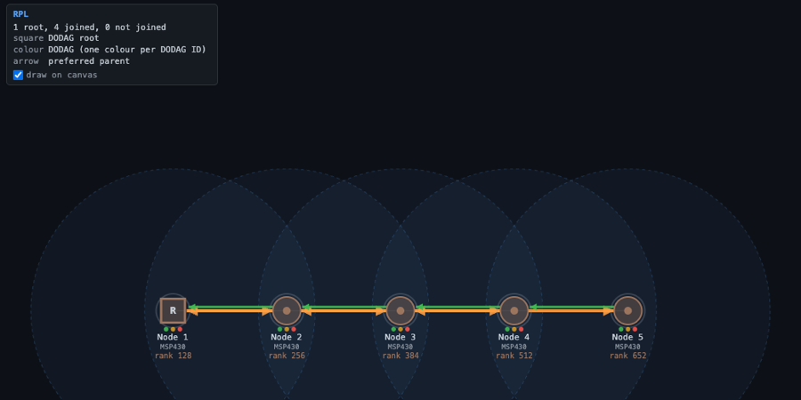

# UI Plugins — contributing a panel to the live web UI

This is the general design for letting a **plugin** draw something in the live
WebSocket UI (`ui/index.html`), added as the v3 increment of the plugin ABI
(`include/sim/csim_plugin.h`). The worked example is the energy estimator
(`src/services/energest_{engine,service}.c`), whose duty-cycle/energy panel is
the UI counterpart to what `packet_sink` is for the headless service ABI.

Both delivery forms publish panels the same way: a dynamic `.so` calls
`api->ui->publish_panel` (the v3 vtable), and a compiled-in built-in calls the
identical-signature kernel function `sim_runtime_ui_publish_panel` directly. The
shared `energest_engine` takes whichever as a sink, so the panel code is written
once.

## The one idea

A plugin **publishes named JSON panels**; the host **transports** them to the
browser over the existing WebSocket; a **single generic renderer** in the page
draws them. The page knows nothing plugin-specific — any plugin that publishes a
panel shows up with zero front-end changes.

```
  observer events  ─▶  plugin  ─▶  ui->publish_panel(sim, "id", json)
                                        │  (stored in sim_runtime: id → latest json)
                                        ▼
  websocket_ui_service, each broadcast tick:
        {"type":"panels","panels":{ "id": <json>, ... }}  ──▶  browser
                                        │
                          renderPluginPanels()  (generic; one box per id)
```

Note the symmetry with how a plugin *consumes* the simulation: structured data
flows **in** as observer events, structured data flows **out** as UI panels.

## The contract (what a plugin author learns)

One call, gated on the v3 capability:

```c
if (api->version >= 3u && api->ui && api->ui->publish_panel)
    /* remember it; call from on_event/destroy with the sim you were handed */
    api->ui->publish_panel(sim, "energest", panel_json);
```

`panel_json` is a small JSON object the generic renderer understands:

```json
{ "title": "Energy (CC2420 @3V)",
  "rows": [ ["mote 0", "duty 100.0%  ~1565 mJ"],
            ["mote 1", "duty  98.8%  ~1043 mJ"] ] }
```

or, for free-form text:

```json
{ "title": "...", "text": "line 1\nline 2" }
```

Rules:
- `id` keys the panel; re-publishing the same `id` **replaces** it (so you push
  a fresh snapshot, you don't diff).
- Publish from `on_event` (or `destroy`). **Do not** rely on `poll()` — the
  service host only polls when a serial/external-command child is active, so a
  plugin's `poll()` won't fire in a normal run. `on_event` always fans out.
- **Throttle.** `on_event` can fire often; rebuild the panel JSON at most every
  ~250 ms of sim time (energest throttles on the event timestamp).
- Keep it small. The panel store holds up to `SIM_RUNTIME_MAX_PANELS` (8)
  panels; each value is a compact object.

## Canvas layers (v4): drawing on the network

A panel may also carry a `layer`: per-node styles and typed links the page
draws **on the topology canvas**, not in a box.  The box then shows the
title, any `text`/`rows`, the legend and a "draw on canvas" checkbox.

```json
{ "title": "RPL",
  "text": "1 root, 4 joined, 0 not joined",
  "layer": {
    "nodes": {
      "1": { "glyph": "square", "fill": "#4e79a7", "ring": "#4e79a7", "badge": "R", "label": "rank 128" },
      "4": { "glyph": "circle", "fill": "#4e79a7", "label": "rank 384" }
    },
    "links": [ { "from": 4, "to": 1, "style": "parent" } ],
    "legend": [ ["square", "DODAG root"], ["arrow", "preferred parent"] ]
  } }
```

The vocabulary is small and protocol-neutral:

| Key | Values |
|---|---|
| `nodes` | keyed by Cooja node id (what the canvas labels "Node N") |
| `glyph` | `circle` (default) \| `hex` \| `square` \| `diamond` |
| `fill`, `ring` | CSS colours; `ring` draws a 3 px outline, `ring_dash: true` dashes it (a sleepy node) |
| `badge` | up to 2 characters drawn in the glyph |
| `label` | short text under the node's name |
| `links[]` | `from`, `to` (node ids), `style`: `parent` (green, arrow to the parent) \| `router` (blue) \| `dashed` \| `plain`; optional `color` |
| `legend` | rows for the box, as `rows` are |

Unknown keys are ignored; a node id the state doesn't have is skipped.
Several layers may be on at once: every one's links are drawn — over the
TX arrows, in a lane a few pixels beside the centre line they run on, so
the structure and the traffic both stay visible — and the first layer that
styles a node gives it its glyph.  Default colours come from the page's theme;
plugin colours are used as given.  Layers ride the same `panels` frame and
`--ui-record`'s `p` deltas, so replays and the browser build draw them with
no change.  `include/sim/sim_layer.h` builds the JSON (escaping included)
with libc only — an out-of-tree plugin can compile `src/sim/sim_layer.c`
into itself.

## Firmware variables (v4): reading a node's state by name

```c
if (api->version >= 4u && api->fw) {
    sim_fwvar_t v;
    if (api->fw->resolve(sim, node, "curr_instance", &v))     /* address, size, machine */
        api->fw->read(sim, node, &v, offset, buf, n);          /* bytes, as stored (LE)  */
}
```

`node` is the slot index observer events carry (`mote_index`);
`fw->node_count` and `fw->node_id` enumerate slots and map them to node
ids.  Reads are **memory only** — ROM, flash and SRAM on ARM, the memory
array on MSP430 — never a peripheral register (reading one can clear a
flag or pop a FIFO, which would change the run), and they never write.
Native, JS, external and Renode nodes have no emulated memory: every call
returns false for them.  Symbols are cached per image, so every node booted
from one image shares the lookups.  Built-ins call `sim_fwvar_*`
(`include/sim/sim_fwvar.h`) directly.

### Struct layouts

A firmware variable is usually a struct whose layout depends on the CPU
and the build configuration, so offsets are not hard-coded.
`tools/gen-struct-layout.py` reads them from the DWARF of an unstripped
image and merges rows into an overlay's layout header
(`src/services/rpl_layout.h`).  The bundled Sky and nRF52840 RPL-UDP images
carry their DWARF: they were rebuilt with `build-device-firmware.sh --debug`
at the commit and with the compiler they were first built with, and
`tools/check-same-program.py` confirms each is the same program (every
allocated section, the entry point, every symbol), so simulations are
unchanged and their layouts come from the images themselves.  For an image
without DWARF, `build-device-firmware.sh --layout HEADER` rebuilds its
example with `-g` (which changes no code) to read the layout, without
rewriting the shipped image.  The browser build serves firmware stripped of
DWARF (`tools/strip-debug.py`).  At run time
`struct_layout_pick()` (`include/sim/struct_layout.h`) chooses the group
whose machine matches the image and whose `sizeof` matches the size the
image's symbol table records for the variable: an image built with another
configuration picks no layout, and the overlay says so instead of reading
the wrong bytes.

## Writing an overlay: the rpl walkthrough



`src/services/rpl_overlay_engine.c` draws Contiki-NG's RPL: the root a
square, every node in its DODAG's colour with its rank, an arrow to its
preferred parent.  Select it with `"plugins": ["rpl"]`.

1. **Sources.**  Every 500 ms of sim time (gated on the event timestamp in
   `on_event`, like energest) it builds each node's view.  From firmware:
   `curr_instance` (used, rank, `min_hoprankinc`, DODAG id, state,
   preferred parent) with the layout picked as above; the parent pointer
   indexes RPL's neighbour table, whose index is the nbr-table key holding
   the parent's link address, matched to the node whose
   `linkaddr_node_addr` it is.  From packets, when there is no layout (or
   no emulated memory): a DIO gives rank and DODAG, a unicast DAO's link
   destination the preferred parent.  `"plugins": ["rpl-packets"]` shows
   the packet view alone.
2. **Mapping.**  Root (`rank == min_hoprankinc`) → `square` with an `R`
   badge; others `circle`; the DODAG id hashed into a ten-colour palette;
   label `rank N` (`*` when it came from packets); link `parent`.
3. **Publishing.**  `sim_layer_begin` / `_node` / `_link` / `_legend` /
   `_note` / `_end`, then `publish(sim, "rpl", json)`.

The engine takes its sinks as a struct (`rpl_overlay_host_t`), so the same
code runs as the built-in (`rpl_overlay_service.c`, kernel calls) or as a
`.so` handed the v3 `ui` and v4 `fw` vtables.  `tools/check-plugin.sh`
checks the DODAG on a Sky chain (firmware and packets) and on Sky +
CC2538 + nRF52840, and that the PCAP is the same with and without it.

Out of scope: writing firmware memory; firmware reads on native, JS and
external nodes (they have no ELF — the packet source covers what they
send, and a later `publish_layer` from the JS mote API could cover the
rest); the old Cooja plugin ABI.

## Why it's safe / additive

- **Version-gated**, append-only ABI: `csim_ui_ops` is a new `csim_api` field;
  a plugin built for v3 checks `api->version >= 3` before touching it, and a v1
  plugin (e.g. `packet_sink`) is unaffected. A pre-v3 host leaves `api->ui`
  NULL, and the plugin degrades to its headless behaviour.
- **Byte-identical when idle**: nothing publishes unless a plugin does, and the
  `{"type":"panels"}` frame is only built when a UI client is connected. No
  plugin / headless / no-client runs are unchanged (verified by cross-build
  empty-diff on sky + cc2538).
- **No new transport**: panels ride the existing WebSocket as a small text
  frame, independent of the full-state JSON and the CBOR delta paths — so the
  hot serialization path is untouched.

## Where the pieces live

| Concern | File |
|---|---|
| ABI (`csim_ui_ops`, `api->ui`, version bump to 3) | `include/sim/csim_plugin.h` |
| Panel store + `sim_runtime_ui_publish_panel` / `_panels_json` | `include/sim/sim_runtime.h`, `src/sim/sim_runtime.c` |
| Wiring the sink into the api handed to plugins | `src/sim/sim_plugin.c` (`g_ui_ops`) |
| Broadcasting the `{"type":"panels"}` frame | `src/services/websocket_ui_service.c` (+ the `rt` handle) |
| Generic renderer + overlay | `ui/index.html` (`renderPluginPanels`, `#plugin-panels`) |
| Example producer | `src/services/energest_engine.c` (+ `energest_service.c`) |
| Firmware reads (v4) | `include/sim/sim_fwvar.h`, `src/sim/sim_fwvar.c`, `api->fw` in `src/sim/sim_plugin.c` |
| Layer JSON builder | `include/sim/sim_layer.h`, `src/sim/sim_layer.c` |
| Struct layouts | `include/sim/struct_layout.h`, `tools/gen-struct-layout.py`, `src/services/rpl_layout.h` |
| Example overlay | `src/services/rpl_overlay_engine.c` (+ `rpl_overlay_service.c`) |
| Layer renderer | `ui/index.html` (`renderPluginPanels`, `activeLayers`, `drawCanvas`) |

`ui/index.html` is served from disk by the UI service, so front-end tweaks need
no rebuild. The renderer is the *only* page change needed for the whole
mechanism — every future plugin reuses it.

## Adding a UI plugin (recipe)

1. In `csim_plugin_init`, record `g_have_ui = (api->version >= 3 && api->ui &&
   api->ui->publish_panel)`.
2. From `on_event`, build a `{title, rows|text}` object (throttled) and call
   `g_api.ui->publish_panel(sim, "<your-id>", json)`.
3. Run with the UI: `./build/test_runner test <cfg> --ui --plugin <your.so>`
   (or config v2 `"plugins": [...]`), open the browser — your panel appears
   over the topology canvas.
4. Verify headlessly without a browser: `CSIM_DUMP_PANELS=1 ./build/test_runner
   ... --plugin <your.so>` prints the published panels to stderr at end-of-run.

## Limitations / future

- **Output only.** Panels are display-only; there is no panel→plugin command
  path yet. A symmetric `{"type":"panel-cmd","id":...}` inbound message routed
  back to the plugin would add interactivity (buttons, toggles).
- **Generic rendering.** The page renders `rows`/`text` and layers generically. A plugin
  that wants bespoke rendering (charts, custom widgets) would need the larger
  "plugin ships a web component served at `/plugins/<id>/ui.js`" model — a
  deliberate future step, not this simple path.
- **One sink.** Panels target the web UI. A headless CSV/file sink for the same
  `publish_panel` data would be a small addition (the data is already
  structured and host-owned).
