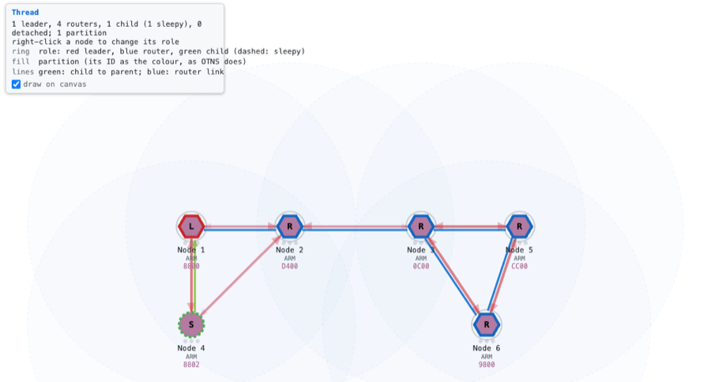

# Running OpenThread on Cooja-NG

Cooja-NG runs **OpenThread**, the Thread stack Matter devices use, on its
emulated CC2538 and nRF52840: the unmodified CLI example from OpenThread's own
bare-metal platform ports. Nodes take a dataset, form a Thread network
(leader, routers, children) and answer pings over MAC-secured 802.15.4
frames:

```
> state
leader
> child table
| ID  | RLOC16 | Timeout    | Age        | LQ In | C_VN |R|D|N|Ver|CSL|QMsgCnt|Suprvsn| Extended MAC     |
+-----+--------+------------+------------+-------+------+-+-+-+---+---+-------+-------+------------------+
|   1 | 0x8801 |        240 |         57 |     3 |  118 |1|1|1|  5| 0 |     0 |     0 | 1e6b07faafeb3c50 |
> ping ff03::1
16 bytes from fdde:ad00:beef:0:d223:a389:95f1:b6fa: icmp_seq=1 hlim=64 time=30ms
```

> **Experimental.** Contiki-NG is Cooja-NG's validated target (it passes the
> upstream Cooja test suite). OpenThread is newer: the cases here work end to
> end, and the gaps are under *Limitations*.

## Coming from OTNS

OTNS, the OpenThread Network Simulator, runs OpenThread's POSIX build with a
simulated radio platform (`ot-rfsim`). Cooja-NG runs the build you would
flash: `ot-cli-ftd` from `ot-cc2538` or `ot-nrf528xx`, compiled for the real
chip, on an emulated CC2538 or nRF52840. The platform layer OTNS replaces runs
here as written: the radio driver, auto-ACK and frame-pending timing, the
flash settings pages, the AES block, the interrupts. Use OTNS to explore a
large Thread topology quickly. Use Cooja-NG when the question is about the
port on that chip, or about a Thread network sharing the air with Contiki-NG,
Zephyr or RIOT nodes.

| In OTNS, or on a board | In Cooja-NG |
|---|---|
| `add router`, `add fed` | `cngsim run firmware/cc2538dk/ot-cli-ftd.cc2538dk -n 6 --ui` starts six CLI nodes, each waiting for a dataset (below); `add <firmware>` in the shell, or the web UI, adds one while it runs |
| `node 1 "state"` | type `state` into node 1's console in the web UI, or `sendln 1 state` from `--shell` or a `--script` |
| `radiomodel` | one unit-disk medium: `radio range 30 60`, `radio success 0.9`, cut links, plus plugin media for random and bursty loss; no path loss or fading (`docs/radio-medium.md`) |
| the OTNS web view | `plugins: [thread]`: the role ring, the partition fill, the RLOC16 and the links, in OTNS's colours ([below](#seeing-the-network-the-thread-overlay)) |
| `speed 100`, `speed max` | `--speed 100`, `--speed max`; a headless run is unpaced |
| OTNS's pcap file | `--pcap out.pcap`; the web UI's Packets tab opens the encrypted frames once a node is given its key with `dataset networkkey`, or you paste it |

A script that forms a two-node network the way you would on two boards (node
1 makes a new dataset and leads, node 2 takes node 1's dataset and attaches
as its child). Save it as `two-nodes.cnsh`; it passes on both bundled images
(run from a checkout, `./build/cngsim`, or an install's `share/cooja-ng`):

```sh
cngsim run firmware/cc2538dk/ot-cli-ftd.cc2538dk -n 2 -t 60s --script two-nodes.cnsh
cngsim run firmware/nrf52840-dk/ot-cli-ftd.nrf52840-dk -n 2 -t 60s --script two-nodes.cnsh
```

```
set max-line 0          # the dataset line is 231 bytes; OpenThread's CLI takes it
sleep 500ms             # let the CLI start
sendln 1 dataset init new
expect 1 "Done" 5s
sendln 1 dataset commit active
sendln 1 ifconfig up
sendln 1 thread start
sleep 10s
sendln 1 state
expect 1 "leader" 5s
sendln 1 dataset active -x
capture ds 1 "^([0-9a-f]{40,})" 5s
sendln 2 dataset set active $ds
sendln 2 ifconfig up
sendln 2 thread start
sleep 10s
sendln 2 state
expect 2 "child" 5s
pass
```

`cmd` (send a line, wait for the prompt, check the output) waits for
Contiki-NG's shell prompt by default; after `set prompt "> "` it waits for
OpenThread's, so `cmd -e "Done" 1 dataset init new` sends, waits and checks
in one line. The commands are in [shell.md](shell.md).

## Limitations

- **Not yet:** border routers; RCP and Spinel, and the POSIX build; sleepy
  end devices with CSL; OpenThread on Zephyr (nRF Connect SDK), the nRF54L15
  and the CC13x2 LaunchPads. This is not a Thread certification harness.
- **Speed:** about 1.5–2.5× real time for two or three nodes, and below real
  time at six (an Apple-silicon laptop). The ports' main loops never sleep,
  so every node runs every cycle.
- **CCA is always idle on the nRF52840** (finding F6 in
  `docs/design/kernel-radio-review-and-performance-plan.md`): nodes that
  answer the same multicast at once collide, and their retries get through.
- **Flash takes no time:** a page erase or a program (CC2538 ROM, nRF52840
  NVMC) completes at once; silicon stalls for it.
- **nRF52840 hardware crypto:** the CryptoCell CC310 is not modelled; the
  default `UART_trans` build stops in its random-number generator. Use
  `soft_crypto`.
- **The radio medium is unit-disk** (`docs/radio-medium.md`):
  range and success ratios, no path loss, fading or capture.

## Quick start

No OpenThread checkout needed: the CLI example is bundled for both boards,
`firmware/cc2538dk/ot-cli-ftd.cc2538dk` and
`firmware/nrf52840-dk/ot-cli-ftd.nrf52840-dk` (each board's
`PROVENANCE.md` says how it was built).

```sh
# The nodes form a Thread network (three CC2538s, two nRF52840s): node 1
# leads, the others join as its children, and node 1's ping to the
# realm-local all-nodes address is answered
./build/cngsim run configs/test-openthread-cc2538dk.yaml
./build/cngsim run configs/test-openthread-nrf52840-dk.yaml

# The same in the browser (click a node for its console)
./build/cngsim run configs/test-openthread-cc2538dk.yaml --ui
```

## Your own network

Each node runs OpenThread's CLI on its console, so a network is set up the
way it is on hardware. Start nodes with `-n`:

```sh
./build/cngsim run firmware/cc2538dk/ot-cli-ftd.cc2538dk -n 3 --ui
```

and type into each node's console in the browser, or drive them from the
shell (`--shell`, [shell.md](shell.md)). Every node needs the same dataset;
start one first so it becomes the leader:

```
dataset networkkey 00112233445566778899aabbccddeeff
dataset channel 15
dataset panid 0x1234
dataset extpanid dead00beef00cafe
dataset networkname cooja-ng
dataset activetimestamp 1
dataset commit active
ifconfig up
thread start
```

`state`, `router table`, `child table`, `ipaddr` and `ping` work as on a
board. A node becomes leader about 7 s after `thread start` when it hears no
network; children are promoted to routers after OpenThread's router selection
jitter (up to 120 s by default).

In a setup file, the dataset goes in as timed `send` / `send_all` actions
under `test:`, and the steps wait for what the CLI prints; the two
`configs/test-openthread-*.yaml` files are complete examples.

## Build your own image

```sh
# CC2538
git clone --recurse-submodules https://github.com/openthread/ot-cc2538
cd ot-cc2538 && OT_CMAKE_NINJA_TARGET=ot-cli-ftd ./script/build
cp build/bin/ot-cli-ftd my-ot.cc2538dk

# nRF52840: the software-crypto build (the CryptoCell is not modelled)
git clone --recurse-submodules https://github.com/openthread/ot-nrf528xx
cd ot-nrf528xx && OT_CMAKE_NINJA_TARGET=ot-cli-ftd ./script/build nrf52840 soft_crypto -DOT_TCP=OFF
cp build/bin/ot-cli-ftd my-ot.nrf52840-dk
```

With binutils 2.45 or later, `ot-cc2538` needs one change to link:
`} > FLASH= 0` in `src/cc2538.ld` written as `} > FLASH = 0`. Without
`-DOT_TCP=OFF` the nRF52840 soft-crypto build fails to link the CLI's TLS
example. The file's extension names the board; or keep the ELF's name and
say `board:` in the setup.

## Seeing the network: the thread overlay



Add `plugins: [thread]` to a config (version 2) and the canvas draws the
network in OTNS's style and colours: the ring is the role (leader red,
router blue, child green, a sleepy child's dashed), the fill is the
partition (its ID used as the colour, as OTNS does, so a partition has the
same colour in both: the ID's low 24 bits, so two partitions that share
them share a fill while the note counts both, and some IDs give a very
dark fill; only the badge turns white on one), the glyph a hexagon for routers and a circle for
children, the label the RLOC16; green lines (arrows) run from children to
their parents and blue ones between routers (grey rings: detached or
disabled).  While a layer is drawn the
radio ranges and the traffic arrows fade back.  It reads each
node's MLE state out of OpenThread's static instance (`ot::gInstanceRaw`)
with offsets from `src/services/thread_layout.h`, picked by the image's CPU
and `sizeof(ot::Instance)`.  `plugins: [thread-packets]` shows what the MAC
headers alone tell (a node's RLOC16 says router or child, and whose child),
without the leader or the partition, which travel inside encrypted MLE.
It forgets a node rebooted, removed or added on its own, and one that has
sent nothing from its RLOC16 for 5 minutes (detached, stopped or gone).
With `thread`, a node whose image has symbols but no OpenThread instance
(Contiki-NG or RIOT in a mixed network) is not drawn, and the note names
it; one with no symbols at all (native, Renode), or an OpenThread build
whose layout has no row, is drawn from its packets.

Right-click a node for its role commands, sent to its console as if typed;
each node offers only those that apply to its role and mode:

- **Become leader of a new partition** (`leaderweight N`, `state leader`).
  OpenThread does not hand over a running partition: `state leader` starts
  a new one, and refuses unless the node's leader weight is above its
  partition's, so N is the partition's weight + 1 (read from the node).
  For a while the canvas shows two partitions; the old one, with the lower
  weight, merges into the new one as its nodes hear it.  Each use leaves
  the new partition one higher, so the weight climbs with every "Become
  leader"; at 255, which nothing is above, the item is shown disabled
  with that reason.  A detached node is in no partition,
  so it gets plain `state leader` (its own weight).
- **Become router** (`state router`, a child that can be one) or **become
  child** (`state child`, a router).  A leader has no "become router":
  OpenThread does nothing for one.
- **Detach and reattach** (`state detached`): the node leaves its
  partition and attaches again, to any partition, by itself.
- **Stop Thread** (`thread stop`): the node is drawn grey as *disabled*,
  and its menu then has **Start Thread** (`thread start`) to bring it back.
  Nodes before their first `thread start` are drawn so too.

A link's far end is found by RLOC16 within the node's own partition:
after a split two partitions can both have a 0x0400, and a router's table
keeps a router that has left until the entry ages out.

`examples/thread-overlay.yaml` puts six CC2538s through a
leader, routers, a sleepy child, a partition split and a merge:

```sh
cngsim run thread-overlay --ui
```

The same overlay exists as a descriptor, a YAML file with no C:
`examples/overlays/thread.yaml` (`overlays: [overlays/thread.yaml]` in a
config; [design/overlay-descriptors.md](design/overlay-descriptors.md)).
Copy it to draw your own protocol state.

## What the emulator provides

OpenThread drives hardware the bundled Contiki-NG images do not use; running
it brought these into the models (CHANGELOG, Unreleased, has the details):

- **CC2538:** the rest of the ROM function table (flash erase and
  programming for the settings pages; memset, memcpy and memcmp were there),
  the alternate interrupt map, frames sent as
  long as their length byte says when the driver writes the FCS bytes too,
  console input at 115200 baud, the auto-ACK one turnaround after the frame,
  and source address matching for its frame-pending bit and
  `SRC_MATCH_FOUND` (without them a sleepy child never attached to a CC2538
  parent).
- **nRF52840:** the NVMC (flash), the ECB AES block cipher, RTC2, EGU1–5, PPI
  channel groups and FORK, the radio's bit counter (address filtering as the
  frame arrives) and MAC header match (ACK matching), UARTE input read
  through RXD, and the PSDU read from RAM as it goes on air (the port
  encrypts the frame in place after starting the transmission).
