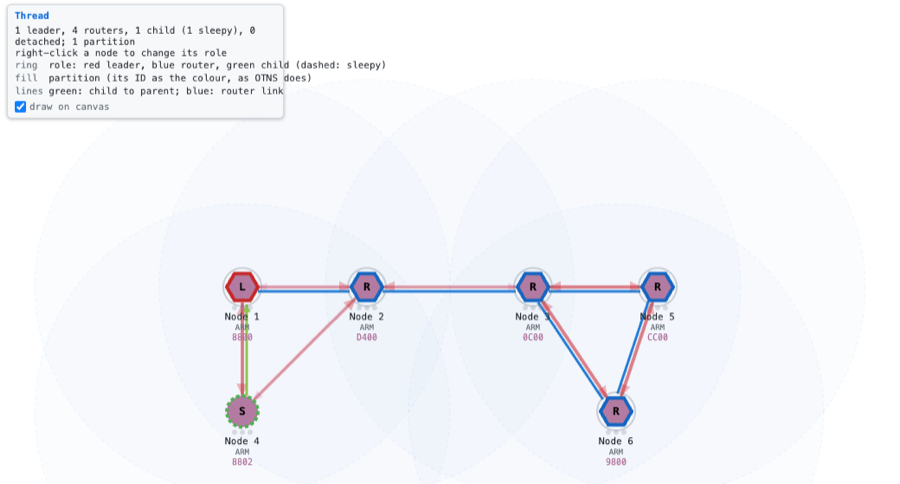

# Running OpenThread on Cooja-NG

Cooja-NG runs **OpenThread**, the Thread stack Matter devices use, on its
emulated CC2538 and nRF52840: the unmodified CLI example from OpenThread's own
bare-metal platform ports. Nodes take a dataset, form a Thread network
(leader, routers, children) and answer pings over MAC-secured 802.15.4
frames:

```
> state
leader
> child table
| ID  | RLOC16 | Timeout    | Age        | LQ In | C_VN |R|D|N|Ver|CSL|QMsgCnt|Suprvsn| Extended MAC     |
+-----+--------+------------+------------+-------+------+-+-+-+---+---+-------+-------+------------------+
|   1 | 0x8801 |        240 |         57 |     3 |  118 |1|1|1|  5| 0 |     0 |     0 | 1e6b07faafeb3c50 |
> ping ff03::1
16 bytes from fdde:ad00:beef:0:d223:a389:95f1:b6fa: icmp_seq=1 hlim=64 time=30ms
```

> **Experimental.** Contiki-NG is Cooja-NG's validated target (it passes the
> upstream Cooja test suite). OpenThread is newer: the cases here work end to
> end, and the gaps are under *Limitations*.

## Quick start

No OpenThread checkout needed: the CLI example is bundled for both boards,
`firmware/cc2538dk/ot-cli-ftd.cc2538dk` and
`firmware/nrf52840-dk/ot-cli-ftd.nrf52840-dk` (each board's
`PROVENANCE.md` says how it was built).

```sh
# Two nodes form a Thread network: node 1 leads, node 2 joins as its child,
# and node 1's ping to the realm-local all-nodes address is answered
./build/cngsim run configs/test-openthread-cc2538dk.yaml
./build/cngsim run configs/test-openthread-nrf52840-dk.yaml

# The same in the browser (click a node for its console)
./build/cngsim run configs/test-openthread-cc2538dk.yaml --ui
```

## Your own network

Each node runs OpenThread's CLI on its console, so a network is set up the
way it is on hardware. Start nodes with `-n`:

```sh
./build/cngsim run firmware/cc2538dk/ot-cli-ftd.cc2538dk -n 3 --ui
```

and type into each node's console in the browser, or drive them from the
shell (`--shell`, [shell.md](shell.md)). Every node needs the same dataset;
start one first so it becomes the leader:

```
dataset networkkey 00112233445566778899aabbccddeeff
dataset channel 15
dataset panid 0x1234
dataset extpanid dead00beef00cafe
dataset networkname cooja-ng
dataset activetimestamp 1
dataset commit active
ifconfig up
thread start
```

`state`, `router table`, `child table`, `ipaddr` and `ping` work as on a
board. A node becomes leader about 7 s after `thread start` when it hears no
network; children are promoted to routers after OpenThread's router selection
jitter (up to 120 s by default).

In a setup file, the dataset goes in as timed `send` / `send_all` actions
under `test:`, and the steps wait for what the CLI prints; the two
`configs/test-openthread-*.yaml` files are complete examples.

## Build your own image

```sh
# CC2538
git clone --recurse-submodules https://github.com/openthread/ot-cc2538
cd ot-cc2538 && OT_CMAKE_NINJA_TARGET=ot-cli-ftd ./script/build
cp build/bin/ot-cli-ftd my-ot.cc2538dk

# nRF52840: the software-crypto build (the CryptoCell is not modelled)
git clone --recurse-submodules https://github.com/openthread/ot-nrf528xx
cd ot-nrf528xx && OT_CMAKE_NINJA_TARGET=ot-cli-ftd ./script/build nrf52840 soft_crypto -DOT_TCP=OFF
cp build/bin/ot-cli-ftd my-ot.nrf52840-dk
```

With binutils 2.45 or later, `ot-cc2538` needs one change to link:
`} > FLASH= 0` in `src/cc2538.ld` written as `} > FLASH = 0`. Without
`-DOT_TCP=OFF` the nRF52840 soft-crypto build fails to link the CLI's TLS
example. The file's extension names the board; or keep the ELF's name and
say `board:` in the setup.

## Seeing the network: the thread overlay



Add `plugins: [thread]` to a config (version 2) and the canvas draws the
network in OTNS's style and colours: the ring is the role (leader red,
router blue, child green, a sleepy child's dashed), the fill is the
partition (its ID used as the colour, as OTNS does, so a partition has the
same colour in both), the glyph a hexagon for routers and a circle for
children, the label the RLOC16; green lines (arrows) run from children to
their parents and blue ones between routers.  While a layer is drawn the
radio ranges and the traffic arrows fade back.  It reads each
node's MLE state out of OpenThread's static instance (`ot::gInstanceRaw`)
with offsets from `src/services/thread_layout.h`, picked by the image's CPU
and `sizeof(ot::Instance)`.  `plugins: [thread-packets]` shows what the MAC
headers alone tell (a node's RLOC16 says router or child, and whose child),
without the leader or the partition, which travel inside encrypted MLE.

Right-click a node for its role commands — become leader (`leaderweight
128`, `state leader`: OpenThread only lets a node take over with a higher
leader weight), become router or child, detach, rejoin — sent to its console
as if typed.  `examples/thread-overlay.yaml` puts six CC2538s through a
leader, routers, a sleepy child, a partition split and a merge:

```sh
cngsim run thread-overlay --ui
```

## What the emulator provides

OpenThread drives hardware Contiki-NG never touches; running it brought these
into the models (CHANGELOG, Unreleased, has the details):

- **CC2538:** the ROM function table (flash erase and programming for the
  settings pages, memset/memcpy), the alternate interrupt map, frames sent as
  long as their length byte says when the driver writes the FCS bytes too,
  console input at 115200 baud, the auto-ACK one turnaround after the frame,
  and source address matching for its frame-pending bit and
  `SRC_MATCH_FOUND` (without them a sleepy child never attached to a CC2538
  parent).
- **nRF52840:** the NVMC (flash), the ECB AES block cipher, RTC2, EGU1–5, PPI
  channel groups and FORK, the radio's bit counter (address filtering as the
  frame arrives) and MAC header match (ACK matching), UARTE input read
  through RXD, and the PSDU read from RAM as it goes on air (the port
  encrypts the frame in place after starting the transmission).

## Limitations

- **Speed:** about 1–3× real time for a few nodes. The ports' main loops
  never sleep, so every node runs every cycle.
- **CCA is always idle on the nRF52840** (finding F6 in
  `docs/design/kernel-radio-review-and-performance-plan.md`): nodes that
  answer the same multicast at once collide, and their retries get through.
- **nRF52840 hardware crypto:** the CryptoCell CC310 is not modelled; the
  default `UART_trans` build stops in its random-number generator. Use
  `soft_crypto`.
- **Not yet:** OpenThread on Zephyr (nRF Connect SDK), the nRF54L15 and the
  CC13x2 LaunchPads; border routers; sleepy end devices with CSL.
